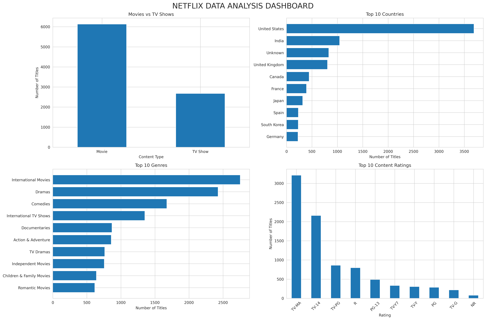

# Netflix Data Analysis Project

## Project Overview
This project focuses on Exploratory Data Analysis (EDA) of Netflix Movies and TV Shows using Python.

The objective is to explore Netflix's content library, identify patterns, understand content distribution, and generate meaningful insights through data analysis and visualization.

## Tools & Technologies
- Python
- Pandas
- Matplotlib
- Seaborn
- Google Colab

## Project Objectives
- Analyze the distribution of Movies and TV Shows.
- Explore content ratings and release years.
- Identify the top countries contributing Netflix content.
- Analyze movie durations and TV Show seasons.
- Explore popular genres.
- Identify the most frequently listed directors and actors.
- Study Netflix content addition trends.
- Create visualizations and a final dashboard.

## Key Analysis Performed
1. Movies vs TV Shows Analysis
2. Content Rating Analysis
3. Release Year Analysis
4. Movie Duration Analysis
5. TV Shows Seasons Analysis
6. Country-wise Content Analysis
7. Content Addition Trend Analysis
8. Genre Analysis
9. Movies vs TV Shows Genre Comparison
10. Directors and Actors Analysis
11. Key Insights and Final Dashboard

## Dashboard

The project includes a dashboard containing four visualizations:

- Movies vs TV Shows
- Top 10 Countries
- Top 10 Genres
- Top 10 Content Ratings

## Files in This Repository

- `Netflix_Data_Analysis.ipynb` – Complete Python analysis notebook.
- `netflix_dashboard.png` – Final project dashboard.

## How to Run the Project

1. Download or clone this repository.
2. Open `Netflix_Data_Analysis.ipynb` using Google Colab.
3. Upload the Netflix dataset and update the file path if required.
4. Run the notebook cells in sequence.
5. Explore the analysis, charts, and findings.

## Conclusion

This project demonstrates the practical application of Python for data analysis and visualization.

It helped explore Netflix's content distribution and identify useful patterns across different categories, countries, genres, ratings, and release years.

## Author

**Your Name**

Aspiring Data Analyst

**Project:** Netflix Data Analysis
